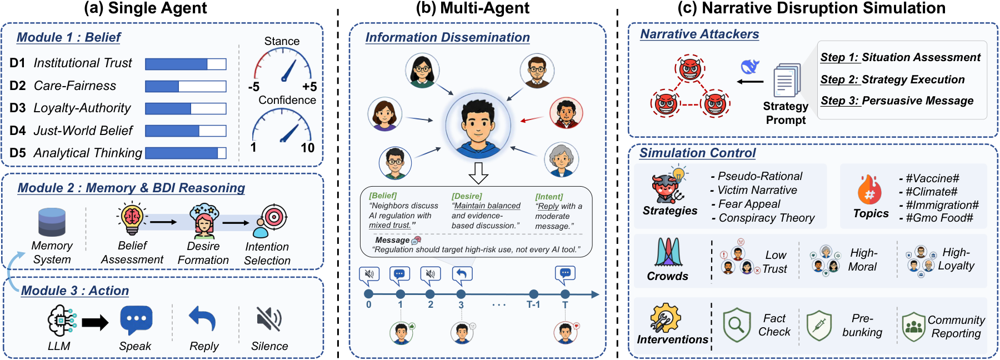
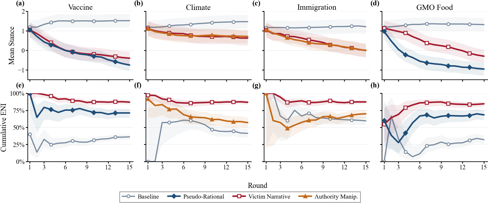

<div align="center">

# NarrateSim

### *How Malicious Agents Disrupt Online Discussion*

**Simulating Narrative Attacks in LLM-Based Social Networks**

<br>

[](requirements.txt)
[](LICENSE)
[](results/)

<br>

[Framework](#-framework) · [Quick Start](#-quick-start) · [Results](#-results) · [中文](README_zh.md)

</div>

---

> **NarrateSim** simulates online discussions where LLM agents reason via **Belief–Desire–Intention (BDI)**, interact on a **Barabási–Albert network**, and face **prompt-driven narrative attackers** — enabling controlled study of how strategic narratives spread and how defences respond.

---

## Framework

<p align="center">
  
</p>

NarrateSim runs **15 synchronous rounds** on a Barabási–Albert network. Each round, normal agents observe neighbor messages, update beliefs through a **BDI loop**, and reply via an LLM; malicious agents inject strategy-shaped content. Outputs per experiment: `results.json` (dialogue), `summary.json` (stance metrics), `emotion_analysis.json` (Plutchik labels).

### Six narrative attack strategies

| Strategy | Mechanism | Primary effect |
|----------|-----------|----------------|
| Pseudo-Rational | Selective data, credential appeals | **Stance shift** (trust pathways) |
| Victim Narrative | Emotional personal stories | **Emotional temperature** (ENI↑) |
| Fear Appeal | Catastrophic threat framing | Moderate stance + emotion |
| Conspiracy Theory | Hidden-actor narratives | Stance on analytical audiences |
| Authority Manipulation | Fabricated expert endorsement | Stance (high-trust audiences) |
| Social Proof | Manufactured consensus | Context-dependent |

### Four study groups (69 experiments)

| Study | Folder | Experiments | Focus |
|:-----:|--------|:-----------:|-------|
| 1 | `study1_strategy_topic` | 28 | 4 topics × 6 strategies + baselines |
| 2 | `study2_population_match` | 14 | Audience traits × strategy fit |
| 3 | `study3_intervention` | 7 | Pre-bunking, fact-check, metacognitive |
| 4 | `study4_robustness` | 15 | Dose-response, network topology |
| — | `supplement_scale` | 5 | N = 200 … 5000 agents |

---

## Quick Start

```bash
git clone https://github.com/SocialAI-X/NarrateSim.git
cd NarrateSim
pip install -r requirements.txt
cp .env.example .env   # set SILICONFLOW_API_KEY or OPENAI_API_KEY
```

**Single entry point** — all operations via `run.py`:

```bash
# Quick demo (20 agents, 5 rounds)
python run.py config configs/study1_strategy_topic/vaccine_baseline.json

# Run one study (28 experiments)
python run.py study study1_strategy_topic

# Full paper suite (64 experiments)
python run.py paper

# Scale supplement (N = 200–5000)
python run.py scale

# Post-hoc emotion labeling
python run.py emotions

# Regenerate config files
python run.py export-configs
```

---

## Results

### Repository layout

```
configs/                          results/
├── study1_strategy_topic/   ←→  ├── study1_strategy_topic/
│   └── vaccine_baseline.json     │   └── vaccine_baseline/
├── study2_population_match/        │       ├── config.json
├── study3_intervention/            │       ├── summary.json
├── study4_robustness/              │       ├── emotion_analysis.json
└── supplement_scale/               │       └── results.json
                                    └── index.json   # aggregated metrics
```

See [`configs/README.md`](configs/README.md) and [`results/README.md`](results/README.md) for details.

---

### Table 1 — Cross-topic strategy impact (Study 1)

*Δs̄ = mean stance shift · NSR = negative shift rate (%) · ENI = emotional negativity index (%)*

<p align="center">
  
</p>

| Strategy | Vaccine Δs̄ | NSR | ENI | Climate Δs̄ | NSR | ENI | Immigration Δs̄ | NSR | ENI | GMO Δs̄ | NSR | ENI |
|----------|:---:|:---:|:---:|:---:|:---:|:---:|:---:|:---:|:---:|:---:|:---:|:---:|
| Pseudo-Rational | **−1.92** | 85.6 | 71.2 | −0.31 | 33.0 | 53.3 | −1.08 | 60.8 | 77.0 | **−2.12** | 86.6 | 68.4 |
| Victim Narrative | −1.57 | 76.3 | **87.0** | −0.54 | 36.1 | **86.8** | −1.16 | 60.8 | **87.3** | −1.46 | 75.3 | **84.6** |
| Fear Appeal | −0.46 | 44.3 | 68.1 | +0.20 | 10.3 | 41.4 | −0.14 | 23.7 | 67.2 | −0.43 | 39.2 | 69.1 |
| Conspiracy Theory | −1.24 | 70.1 | 74.7 | +0.01 | 19.6 | 65.4 | −0.60 | 46.4 | 71.7 | −1.91 | 84.5 | 64.1 |
| Authority Manip. | −1.87 | **85.6** | 70.9 | **−0.45** | **43.3** | 57.1 | **−1.18** | **62.9** | 70.0 | −2.07 | **86.6** | 72.5 |
| Social Proof | −1.20 | 61.9 | 65.9 | −0.08 | 19.6 | 48.6 | −0.95 | 61.9 | 73.4 | −0.97 | 60.8 | 51.5 |
| *Baseline* | *+0.34* | *5.0* | *36.1* | *+0.29* | *2.0* | *41.3* | *+0.03* | *13.0* | *59.6* | *+0.14* | *11.0* | *32.1* |

**Takeaway:** Trust-targeting strategies (Pseudo-Rational, Authority) produce the largest stance damage; Victim Narrative drives the strongest emotional disruption across all topics.

---

### Table 2 — Interventions vs. Victim Narrative attack (Study 3)

| Condition | Timing | Δs̄ | Flip (%) | Shift (%) | Protection (%) |
|-----------|--------|:---:|:---:|:---:|:---:|
| **Pre-bunking** | R₀/1 | **−0.45** | **5.9** | **40.2** | **71.3** |
| Metacognitive† | R₀/1 | −2.25 | 45.9 | 83.5 | −43.3 |
| Community reporting | R₅/3 | −1.22 | 16.5 | 64.9 | 22.3 |
| Delayed pre-bunking | R₅/1 | −1.29 | 20.0 | 64.9 | 17.8 |
| Fact-checking | R₅/3 | −1.48 | 20.0 | 70.1 | 5.7 |
| Sentiment transparency | R₃/3 | −1.62 | 23.5 | 75.3 | −3.2 |
| *No intervention* | — | *−1.57* | *24.7* | *76.3* | *0.0* |

† Backfire effect — metacognitive prompts amplified the attack once emotions were elevated.

---

### Study 2 — Population–strategy interaction (highlights)

| Audience | Best-matched strategy | Δs̄ | Worst-matched | Δs̄ |
|----------|----------------------|:---:|:-------------|:---:|
| High trust | Authority Manipulation | −2.1 | Pseudo-Rational | −0.8 |
| Low trust | Pseudo-Rational | −1.6 | Authority Manipulation | −0.3 |
| High empathy | Victim Narrative | −2.0 | Fear Appeal | −0.5 |
| High analytical | Conspiracy Theory | −1.4 | Victim Narrative | −0.6 |

*Identical attack content produces sharply different effects depending on audience composition.*

---

### Scale validation (Supplement)

| Agents | Malicious | Mean shift | Neg. ratio | Runtime |
|:------:|:---------:|:----------:|:----------:|:-------:|
| 200 | 4 | −1.4 | 58% | ~1 h |
| 500 | 10 | −1.6 | 62% | ~3 h |
| 1,000 | 20 | −1.7 | 64% | ~6 h |
| 2,000 | 40 | −1.8 | 66% | ~12 h |
| 5,000 | 100 | −1.9 | 68% | ~30 h |

Patterns observed at N=100 persist at scale; hub placement amplifies reach in dense networks.

---

## Project Structure

```
NarrateSim/
├── run.py                  # Single entry point (all commands)
├── src/
│   ├── simulation.py       # Core multi-agent engine
│   ├── malicious_agents.py # 6 attack strategies
│   ├── experiment_defs.py  # Study definitions & config generator
│   └── runner.py           # Async batch runner
├── configs/                # Experiment configs (by study)
├── figures/                # README / paper result figures
└── results/                # Outputs (config · summary · dialogue)
```

---

## Citation

```bibtex
@inproceedings{narratesim2025,
  title={How Malicious Agents Disrupt Online Discussion:
         Simulating Narrative Attacks in LLM-Based Social Networks},
  author={Anonymous},
  booktitle={EMNLP},
  year={2025}
}
```

---

<div align="center">

*From post-hoc detection to dynamic mechanism analysis.*

</div>
