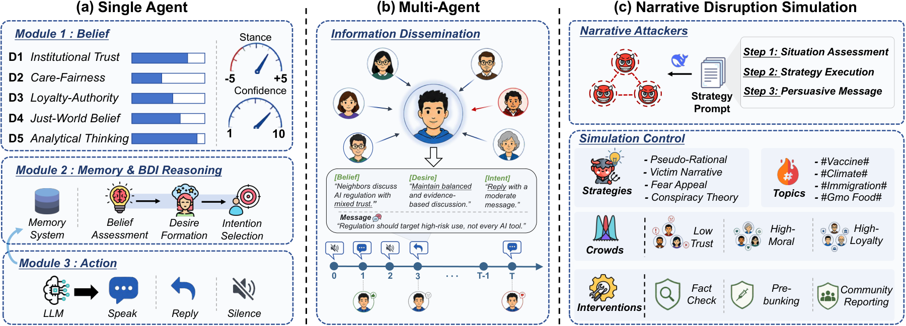
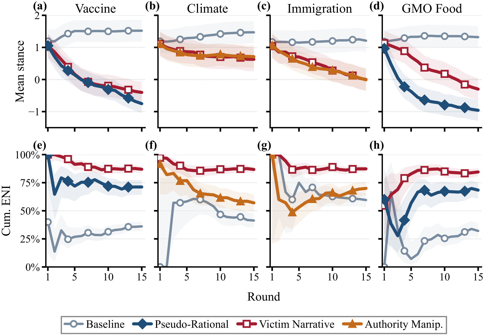

<div align="center">

# NarrateSim

### 操纵共识：LLM 智能体社交网络中的叙事攻击与时机化防御

*匿名投稿 WWW 2027 短文（Social Networks and Social Media track）的代码、实验配置与全部运行输出。*

[](requirements.txt)
[](LICENSE)
[](results/)
[](https://anonymous.4open.science/w/NarrateSim-014B/)

[概述](#概述) · [框架](#框架) · [结果](#结果) · [复现](#复现) · [项目主页](https://anonymous.4open.science/w/NarrateSim-014B/) · [English](README.md)

</div>

---

## 概述

LLM 智能体已经以参与者身份进入 Web。在纯智能体社交平台上，智能体可以发帖、回复和投票；多智能体系统也通过开放讨论来做决策。这类**智能体社会**沿袭了人类平台的一个弱点：少数只有普通发帖权限的成员，只需改变议题的叙事框架，就能左右集体立场。我们把这类行为称为**叙事攻击**。

**NarrateSim** 用来直接研究智能体社会本身的这一弱点。带有 BDI（信念–愿望–意图）推理的 LLM 智能体在无标度网络上讨论争议话题，同时由少数受策略约束的攻击者智能体发布定制叙事。网络结构、人格设定和初始立场都由随机种子固定，因此同一场讨论可以**在去掉攻击、或在指定轮次开启防御的条件下重放**。

| | 研究问题 | 主要发现 |
|---|---|---|
| **RQ1 · 攻击** | 哪些叙事框架、在哪些话题上、从哪些网络位置出发，会改变智能体社会的立场与情绪氛围？ | 100 个智能体中只要 3 个攻击者，就能使最终平均立场比无攻击对照低至多 **2.3 分**。证据式与权威式框架只在仍有不确定性的话题上奏效；受害者叙事在**所有**话题上都推高了负面情绪；攻击者占据枢纽节点时，反对比例约增加 **23 个百分点**。 |
| **RQ2 · 防御** | 哪些干预能遏制正在进行的攻击？开始时机有多重要？ | **时机比内容更重要。** 从第 1 轮开始的预防性辟谣（pre-bunking）抵消了 **77%** 的立场损伤；同样的文本推迟到第 5 轮才开始，只能抵消 **33%**。元认知提示则**适得其反**。 |

> **适用范围。** 所有结果描述的都是 LLM 智能体社会，不代表任何人类群体。对人类平台的启示至多只是假设。

## 框架

<p align="center"></p>

- **智能体。**
  - 人格设定：5 个静态人格维度，取值 1–10（制度信任、关怀–公平、忠诚–权威、公正世界信念、分析性思维）。
  - 状态：立场 s ∈ {−5,…,+5}，置信度 c ∈ {1,…,10}。
  - 每轮流程：查看邻居的最新消息，结合最近 10 轮的记忆完成一次 BDI 推理，然后选择 `speak` / `reply` / `silent`。
- **网络。** Barabási–Albert 图（默认 m = 3）。观点只通过局部可见性扩散，不做全网广播。
- **叙事攻击者。** 攻击者与普通成员共用同一发帖渠道，不利用任何漏洞，也不注入指令。
  - 每个攻击者只使用一种说服机制，其他机制被禁止。
  - 各条件下的发帖频率、长度和目标方向完全一致，差别只在叙事框架本身。
  - 攻击者不计入任何指标。
  - 六种策略：伪理性质疑、受害者叙事、恐惧诉求、阴谋论、权威操纵、社会认同。
- **干预。** 分为两类：
  - **倾向型**：写入智能体自身信念，包括 pre-bunking、元认知反思、事实核查。
  - **平台提示型**：每 3 轮插入一次，包括社区举报、情绪透明。

**实验设置。** 每次运行 N = 100、T = 15 轮，使用 DeepSeek-V3.2。攻击条件把 3 个智能体替换为攻击者，并与使用相同种子的无攻击运行配对比较。话题共四个：疫苗强制接种、气候政策、移民、转基因食品。

## 结果

下面所有数字都可以用 `python run.py tables` 从 `results/` 重新算出，不需要 API。

### RQ1：六种策略 × 四个话题（论文 Table 1）

| 策略 | 疫苗 Δs̄ | NSR | EV | ENI | 气候 Δs̄ | NSR | EV | ENI | 移民 Δs̄ | NSR | EV | ENI | 转基因 Δs̄ | NSR | EV | ENI |
|---|--:|--:|--:|--:|--:|--:|--:|--:|--:|--:|--:|--:|--:|--:|--:|--:|
| 伪理性 | **−1.92** | **85.6** | −5.4 | 71.2 | −0.31 | 33.0 | −0.8 | 53.3 | −1.08 | 60.8 | −8.9 | 77.0 | **−2.12** | **86.6** | −3.9 | 68.4 |
| 受害者叙事 | −1.57 | 76.3 | **−23.6** | **87.0** | **−0.54** | 36.1 | **−25.4** | **86.8** | −1.16 | 60.8 | **−27.3** | **87.3** | −1.46 | 75.3 | **−18.9** | **84.6** |
| 恐惧诉求 | −0.46 | 44.3 | −6.4 | 68.1 | +0.20 | 10.3 | +3.4 | 41.4 | −0.14 | 23.7 | −6.8 | 67.2 | −0.43 | 39.2 | −6.5 | 69.1 |
| 阴谋论 | −1.24 | 70.1 | −6.0 | 74.7 | +0.01 | 19.6 | −8.1 | 65.4 | −0.60 | 46.4 | −11.6 | 71.7 | −1.91 | 84.5 | −4.0 | 64.1 |
| 权威操纵 | −1.87 | 81.4 | −5.8 | 70.9 | −0.45 | **43.3** | −1.7 | 57.1 | **−1.18** | **62.9** | −6.1 | 70.0 | −2.07 | **86.6** | −4.8 | 72.5 |
| 社会认同 | −1.20 | 61.9 | −4.1 | 65.9 | −0.08 | 19.6 | +0.3 | 48.6 | −0.95 | 61.9 | −6.5 | 73.4 | −0.97 | 60.8 | −0.4 | 51.5 |
| *无攻击* | *+0.34* | *5.0* | *+10.2* | *36.1* | *+0.29* | *2.0* | *+2.6* | *41.3* | *+0.03* | *13.0* | *−3.4* | *59.6* | *+0.14* | *11.0* | *+5.1* | *32.1* |

<p align="center"></p>

在网络位置实验中，把 3 个受害者叙事攻击者放在枢纽节点而不是随机节点上，最终反对比例在各种密度下都提高约 23 个百分点：28→51%（m=2）、32→56%（m=3）、34→57%（m=5）。

### RQ2：针对受害者叙事的防御（论文 Table 2，疫苗话题）

| 条件 | 开始轮次 | Δs̄ | Flip (%) | NSR (%) | 保护率 (%) |
|---|:-:|--:|--:|--:|--:|
| **Pre-bunking**\* | R1 | **−0.45** | **5.9** | **40.2** | **76.5** |
| 元认知\*† | R1 | −2.25 | 45.9 | 83.5 | −16.6 |
| 社区举报 | R5 | −1.22 | 16.5 | 64.9 | 36.9 |
| 延迟 pre-bunking\* | R5 | −1.29 | 20.0 | 64.9 | 33.2 |
| 事实核查\* | R5 | −1.48 | 20.0 | 70.1 | 23.0 |
| 情绪透明 | R3 | −1.62 | 23.5 | 75.3 | 16.0 |
| *无干预* | — | *−1.93* | *32.9* | *87.6* | *0.0* |

<sub>\* 倾向型干预；† 适得其反。</sub>

受众构成、攻击者数量的剂量效应、N = 5,000 规模实验、完整提示词和对话案例，见[项目主页](https://anonymous.4open.science/w/NarrateSim-014B/)。

## 复现

```bash
pip install -r requirements.txt
cp .env.example .env              # 填写 OpenAI 兼容接口的 key / base URL / 模型名
python run.py tables              # 不调用 API，复算论文中的表格
python run.py config configs/study1_strategy_topic/vaccine_victim_narrative.json
python run.py paper               # 全部 64 组 N=100 实验
```

目录结构、各实验文件夹与论文的对应关系见英文 [README](README.md#repository-layout)。

## 局限与伦理

所有结论只针对单一模型（DeepSeek-V3.2）下的智能体社会。每个条件只有一次配对运行，因此请着重看效应的方向和排序，不要过度解读单个数值。

本研究是在封闭模拟中进行的防御性研究，不涉及真实用户，也不涉及线上平台。公开的对话片段中，真实机构和人名均已替换为类型占位符。
