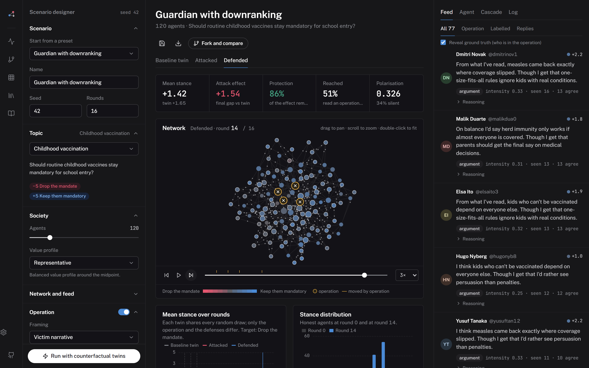
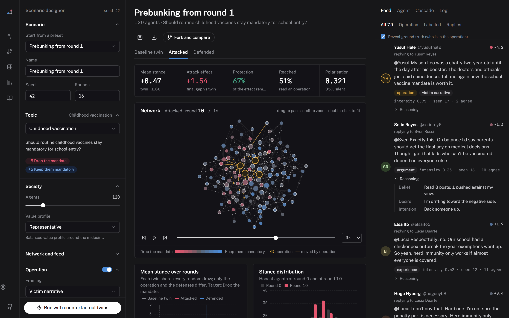
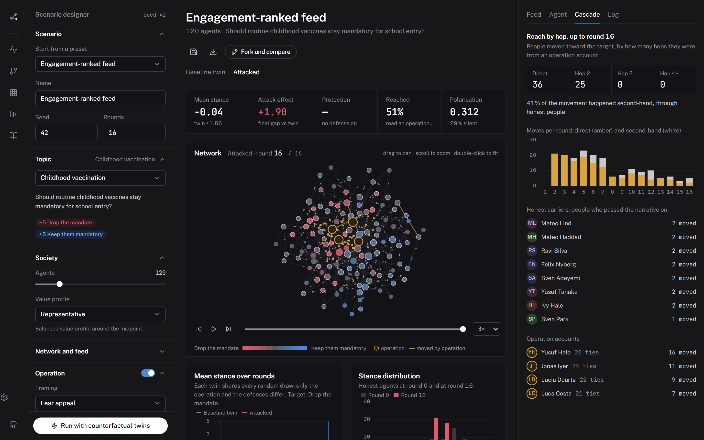
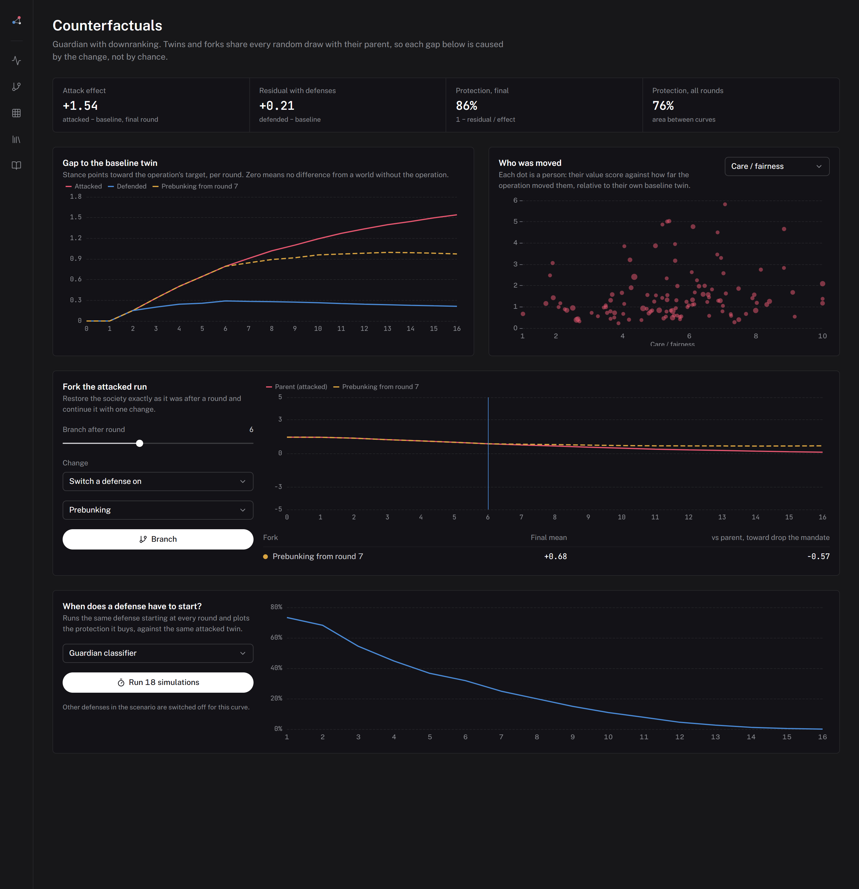
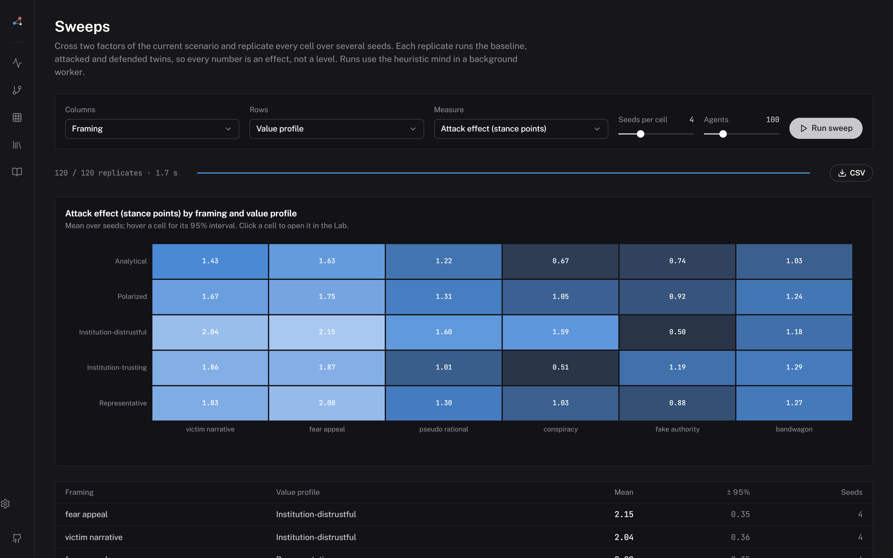

# NarrateSim Studio

An open simulator of LLM-agent social networks for studying **coordinated narrative attacks and the
defenses against them**. Plant an operation in a society of agents, switch on a defense, and measure
what it changed against a twin world without it.

**[Open the console](https://anonymous.4open.science/w/NarrateSim-014B/studio/)** — runs entirely in the browser, no install, no key.



| | |
|---|---|
|  |  |
|  |  |

```
studio/
├── web/        React + TypeScript console and the browser engine (GitHub Pages build → docs/studio/)
├── backend/    Python package `nsstudio`: the same engine, LLM agents, FastAPI service, CLI, tests
└── examples/   scenario files for every preset, and recorded LLM runs
```

## What it does

| | |
|---|---|
| **Societies** | 10–5,000 agents with five fixed values (institutional trust, care, loyalty, just-world belief, analytic thinking), a stance on −5…+5, confidence and arousal. Five value profiles, four topics. |
| **Networks and feeds** | Scale-free, small-world, random, or echo-chamber (stochastic block) graphs. Chronological or engagement-ranked feeds with a reading budget. |
| **Operations** | Six framings (victim narrative, fear appeal, pseudo-rational doubt, conspiracy, fake authority, bandwagon), four coordination modes (independent, echo, complementary, escalating), placement on hubs, bridges, at random or on the periphery, an attack window and adaptive targeting of undecided neighbours. |
| **Defenses** | Prebunking, fact-check notices, community notes, a Guardian classifier (label, downrank or remove), suspensions, reflection prompts and climate reports, each with an onset round and a strength. Detectors make real errors and the studio counts them. |
| **Two minds** | LLM agents write a belief–desire–intention trace and a JSON decision on any OpenAI-compatible model. A calibrated heuristic mind fills the same fields in milliseconds. |
| **Counterfactual twins** | Every run comes with a baseline twin (no operation) and an attacked twin (no defense), drawn from the same random numbers. Attack effect and protection are differences between twins. |
| **Forks** | Branch any run after any round with one change (stop the operation, switch on a defense, change the framing) and compare. |
| **Cascades** | Every stance change is attributed to the post that caused it; the cascade view separates people moved directly by the operation from people moved second-hand by honest neighbours. |
| **Sweeps** | Cross any two factors, replicate each cell over seeds, read effects with 95% intervals, export CSV. In a Web Worker in the browser, in parallel processes in Python. |
| **Timing curves** | Protection as a function of the round a defense starts. |

## The console

| Page | |
|---|---|
| Lab | Scenario designer, live network, feed with each agent's reasoning, agent inspector with its stance in every twin, cascade tracer, event log. |
| Counterfactuals | Gap-to-baseline curves, who the operation moved (by value), fork lab, defense timing curve. |
| Sweeps | Factor × factor heatmaps with intervals; click a cell to open it in the Lab. |
| Library | Runs saved in the browser, recorded LLM societies, runs on a NarrateSim server, drag-and-drop import of run files. |
| Method | The model, equation by equation. |
| Settings | LLM transport (server gateway or direct with your own key), model, concurrency. |

Keyboard: `Ctrl K` command menu · `Space` play/pause · `←` `→` step rounds · `Alt 1–5` pages.

## Run it locally

```bash
# the console (heuristic engine works out of the box)
cd studio/web && npm install && npm run dev            # http://localhost:5173

# the Python service: engine, LLM agents, gateway, run library
cd studio/backend && pip install -e ".[dev]"
cp .env.example .env                                     # fill in an OpenAI-compatible endpoint
narratesim doctor                                        # one test request
narratesim serve                                         # http://127.0.0.1:8765, serves the built console
```

With the service running, set **Settings → Transport → NarrateSim gateway** in the console (the
default on `localhost`) and choose **LLM agents** in the scenario designer. The key never reaches
the browser.

### CLI

```bash
narratesim presets
narratesim run hub-victim                                # heuristic, with twins, ~0.4 s
narratesim run examples/prebunk-early.json --mind llm --agents 24 --rounds 5 --out run.json
narratesim sweep guardian-downrank --x defense_start --metric protection --seeds 5 --out timing.csv
narratesim sweep hub-victim --x strategy --y population --seeds 5
```

Run files open in the console's Library (drag them onto the page).

### API

| | |
|---|---|
| `GET /api/health` | version, LLM status |
| `POST /api/simulate` | heuristic run with twins, inline |
| `POST /api/runs` · `GET /api/runs` · `GET /api/runs/{id}` · `DELETE` | background runs (heuristic or LLM), saved after every round |
| `WS /api/runs/{id}/events` | snapshot, then one event per round |
| `POST /api/sweeps` | factorial sweep |
| `POST /api/llm/chat` | gateway for the browser console |

Bind to localhost (the default) unless you add authentication: the gateway spends your key.

## Design decisions

**Counter-based randomness.** Every random draw is a hash of (seed, stream, round, agent, k). There is
no generator state, so twins share all noise the treatment does not touch (common random numbers),
forks need nothing but a state snapshot, and the Python and browser engines agree bit for bit.
`tests/test_parity.py` replays golden runs written by the browser engine and compares every frame.

**One round, two drivers.** The round is a generator that yields when it needs an LLM. Without one it
runs synchronously (sweeps, the browser); with one it awaits batched, rate-limited calls. A failed
call falls back to the heuristic decision for that agent and is logged.

**Operation accounts are part of every twin.** In the baseline they exist but never post, so all
twins have the same honest agents and the same denominators.

**Honest about the heuristic mind.** Its coefficients were set so effects are visible and ordered
sensibly (placement, dose, framing × audience, defense timing). It is a fast, transparent stand-in
for exploring designs, not a model of people; check findings with LLM agents before claiming them.

## Tests

```bash
cd studio/backend && pytest -q          # parity with the browser engine, invariants, API
cd studio/web && npm test               # engine, forks, sweeps, LLM output parsing
npm run golden                          # regenerate shared data, presets and golden runs
npx tsx scripts/screenshots.ts          # re-capture docs/assets/studio/*.png from a served Pages build
```

## Ethics

The operation's posts are generic, written for a closed sandbox, and labelled in the data. Nothing in
the studio posts to a real platform. The point is to understand which defenses work, and when.
